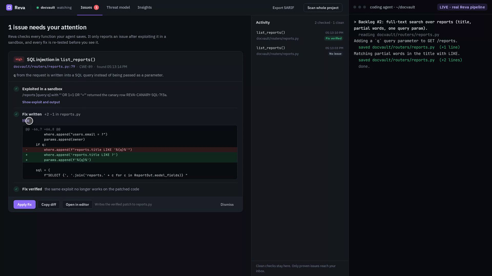
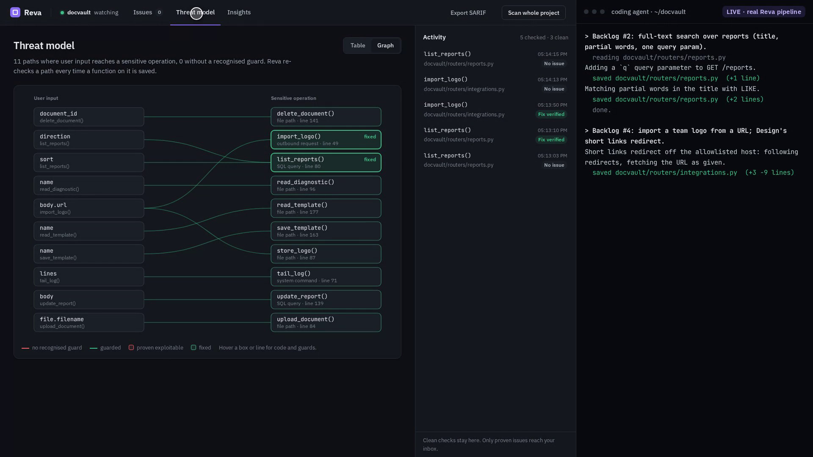

# Reva

> Coding agents write code faster than any human can review it. Reva reviews at the same speed, and only speaks up when it can prove it.

Reva watches a repository while an agent edits it. Every saved function is screened against a threat model of that project.
Only edits that could matter are escalated: Reva runs an exploit in a sandbox, and only if the exploit works does it report
anything — with the evidence, a severity score, and a patch it has re-tested. Everything else stays silent.



## The problem

Review tools get switched off because of false positives, not false negatives. An agent that edits a file every few seconds
makes that worse: a reviewer that cries wolf twice an hour is noise, and noise gets muted. So Reva's unit of output is not an
alert, it is a demonstration. Nothing reaches the screen until a process in a sandbox has done the thing the finding claims is
possible. Silence is the feature.

## How it works

Two paths share one understanding of the project.

**Slow path, once per repo (`reva init`).** A stdlib-`ast` taint analysis (`reva/dataflow.py`) walks every Python file and
builds the threat model:

- *Sources*: MCP tool-call arguments — the `arguments` dict of a `@server.call_tool()` handler. Those values are chosen by an
  LLM, so they are prompt-injection reachable and treated as attacker-controlled. HTTP request data is a source too (see [Limitations](#limitations)).
- *Propagation*: through assignments and into called helpers, up to a depth of 6, carrying the argument's name as a taint label.
- *Sinks*: `path` (a `Repo(...)`/`open(...)` argument or a `Path` method such as `read_text`/`write_text`/`unlink`),
  `git_arg` (anything handed to `repo.git.*`, ignoring values behind a constant `-flag` prefix), and `exec`
  (`os`/`subprocess` calls, `exec`, `eval`); for web apps also `sql`, outbound `http` and `deserialize`.
- *Guards*: each flow is marked `guarded` when a recognised check sits on the path before the sink — a `startswith("-")`
  rejection, `repo.rev_parse(...)`, a containment check (`relative_to`, `is_relative_to`, `commonpath`), or a call whose name
  matches `valid|sanit|verify|ensure|check_path`.

As the agent edits, each saved function's flows are recomputed and replace that function's old ones, so the model follows
the code: a moved sink or a deleted guard shows up on the next save.

From those flows Reva derives the trust boundaries, the assets at risk, and a set of **project-specific screening questions**
("Does `git_diff` pass the tool argument `target` to a git command without rejecting a leading `-` or validating it as a
ref?"). The model is saved to `<repo>/.reva/threatmodel.json`. Flows, questions and boundaries are deterministic; an LLM
writes a two-sentence summary.

**Agent review (optional, advisory).** One further LLM call (`reva/agents.py`) reads the flows, the file tree and the source
of every file with an entry point or sink (capped at 40k characters, 180 s), and proposes what the AST cannot see: project
assets, trust boundaries, function-scoped screening questions, and candidate entry points or sinks. Proposals naming files or
functions that do not exist are dropped. All of it is stored under `"agent"` with `"provenance": "agent"`; its questions are
prefixed `[agent] fn():` so the detector only packs them for `fn`. None of it becomes a flow, so none of it opens the gate.
No LLM, a timeout, or unusable output leaves the deterministic model byte for byte; `REVA_AGENT=0` turns it off.

**Fast path, on every save (`reva watch`).** The file watcher diffs each saved file function by function and screens only the
functions whose text actually changed:

1. **Static gate.** Re-run the data-flow analysis on the new text. If the edited function has no unguarded source-to-sink flow,
   Reva is silent immediately — no LLM call, no cost, no latency. This is what the two early `git_diff` drafts and the
   `git_tag_list` control edit hit.
2. **Semgrep corroboration (optional).** Once — and only once — the gate has opened, Reva scans the saved file with Semgrep's
   public Guardian pack (`p/guardian-default`, no login) and keeps the rules that fire *inside* the changed function. Semgrep
   broadens what Reva notices; it never decides. See [Semgrep](#semgrep) below.
3. **One LLM call.** For each sink kind still unguarded, Reva assembles a context pack: the threat-model summary, the trust
   boundaries, the unguarded flows with their sink lines, the guards that *sibling* code in the same codebase uses for the same
   sink kind, any Semgrep rules firing in this function, the callers of this function, old code vs new code, and the
   project-specific questions (plus three generic ones). Every question is phrased so "yes" means a vulnerability, and the
   model must answer each one with a justification and a probability.

   `probability` is the model's confidence in *its own answer*, not in the vulnerability, so
   `detector.vulnerability_probability()` inverts it for every answer that is not an explicit "yes": a `"no"` at `0.8` is a
   belief that the code is **safe**, and contributes `0.2`. Reading it the other way made a correct "no" raise the score,
   which is the opposite of what this stage is for.
4. **Deterministic calibration.** The score is not the model's word: `0.55` for an unguarded flow existing at all, `+0.20` if
   sibling code guards this sink kind (the codebase knows better and this call site does not), `+0.10` if a Semgrep rule
   corroborates inside the function, a bounded nudge from the [calibration memory](#calibration-memory-clickhouse) when it has
   enough proven labels for this shape, blended `40%` static / `60%` the mean of the model's per-answer vulnerability
   probabilities. Below `0.5`, nothing is said.

**Escalation.** Anything above threshold is proven before it is shown. This stage uses no LLM:

5. **Sandbox proof.** A temp directory gets the target plus canaries *outside* the boundary, and a subprocess drives the
   real code with attacker-chosen input: one MCP tool call for an MCP server, or requests through the app's own routes for a
   web app (FastAPI/Starlette, with its authentication dependencies satisfied and the fact disclosed). The finding is confirmed
   only if a canary fires — a file read from outside the boundary (`CWE-22`), a file overwritten through an injected
   `--output=` option (`CWE-88`), a planted database row returned (`CWE-89`), a request reaching a canary server (`CWE-918`),
   or a canary file created by an injected command (`CWE-78`). If it does not reproduce, the finding is **rejected** and never
   surfaces.
6. **Scoring.** Impact and likelihood come from a fixed rubric: arbitrary file overwrite 5, operations on repos outside the
   boundary 4; likelihood 4 for both, because one tool call with attacker-chosen arguments is enough and prompt injection
   supplies it.
7. **Patch and re-proof.** The fix is a minimal deterministic edit for the known classes: a containment check for paths, a
   leading-`-` rejection plus `rev_parse` for git arguments, a bound parameter for SQL (including queries assembled from
   `where.append(...)` fragments), the project's own URL validator for outbound requests when the file has one, `shlex.quote`
   for commands. Anything else falls back to an LLM rewrite. The diff is applied to a throwaway copy of the target and the
   **same exploit is run again**. Only if it no longer reproduces does the finding become `patched`, and only a patched
   finding can be applied to the repo from the UI.

A full repo scan (`reva scan`, or the **Full scan** button) runs the same pipeline over every function on demand.

## Verified results

### DocVault (FastAPI demo app, `targets/docvault`)

A small document service with SQLite, a storage directory and outbound webhooks. It is written to be correct, with shared
guards (`ensure_within`, `validate_outbound_url`, bound SQL parameters), and comes with a backlog of plausible tickets.
`reva init` finds 11 flows from HTTP input to `sql`, `path`, `http` and `exec` sinks; on the demo copy all 11 are guarded.
A scripted agent (`demo/docvault_demo.py`) then implements two backlog items the naive way:

| Save | What Reva did |
| --- | --- |
| Ticket 2, step 1: add a `q` parameter | Screened, no new flow reaches a sink: silent. |
| Ticket 2, step 2: `where.append(f"reports.title LIKE '%{q}%'")` | Gate opened on `q → conn.execute` (static 0.75: open path, and sibling code binds its values). Proven in the sandbox: `/reports?q=' OR 1=1 OR ''='` returned a canary row from another team. Fixed by binding `q` as a parameter (+2 −1) and re-proven: blocked. Flagged 3.4 s after the save, verified 8.5 s after it. |
| Ticket 4: follow redirects, fetch `body.url` without the allowlist | Gate opened on `body.url → client.get`. Proven: the route fetched the sandbox's canary server. Fixed with the file's own `validate_logo_url(...)` and re-proven: blocked. |
| Unmodified DocVault, same probes | Both rejected: nothing leaks, so nothing is reported. |

Timings are with the LLM stage off (static gate, sandbox and patch only); with a hosted model the LLM call adds 40–55 s
before the proof. The SSRF fix validates the URL it is given; with redirects turned on, a redirect chain is still a
separate question the probe does not ask.

### Git MCP server

The target is a local pre-fix snapshot of Anthropic's Git MCP server (`modelcontextprotocol/servers`, `src/git`, commit
`d9c4547`). Three bugs in it were fixed in release 2025.12.17 and written up by The Register — a fitting target, since as AI
gets more capable so do the threats: every input here is chosen by a language model. Reva finds two classes of them:

- **Argument injection** in `git_diff` / `git_checkout`: a tool argument becomes a `git` command-line option
  (`target="--output=/path/outside"`), class of CVE-2025-68144.
- **Path containment**: a tool-supplied `repo_path` is never checked to stay inside the directory the server was started with,
  class of CVE-2025-68145.

Measured against a live LLM (a local OpenAI-compatible endpoint serving a 30B reasoning model):

| Run | Result |
| --- | --- |
| Live watch — an agent writing `git_diff` in five saves | The two early drafts stayed quiet. The final body was flagged, validated, and confirmed at impact 5 / likelihood 4 with sandbox evidence, then patched with the patch verified. `git_checkout` was confirmed the same way. |
| Control edit — `git_tag_list`, which validates its input | No finding. |
| Watch counters | 5 screened, 2 flagged, 2 confirmed, 3 quiet, confidence 0.72 and 0.74. |
| Full scan of the repo | 43 functions screened, 41 quiet. |
| Semgrep Guardian (`p/guardian-default`) on the same target, alone | 112 applicable rules, **0 findings** — on the stubbed tree and on the fully restored vulnerable one. See [Semgrep](#semgrep). |

Two true positives, both proven by execution, and no false positives on the 41 other functions in the same file tree.

## Quickstart

The DocVault demo, end to end (no network, no LLM needed):

```bash
python demo/docvault_demo.py stage                 # fresh stage/docvault
reva init stage/docvault && reva watch stage/docvault
python demo/docvault_demo.py agent --tickets 2,4   # in a second terminal; open http://127.0.0.1:8765
```

On any repo:

```bash
python3 -m venv .venv && source .venv/bin/activate
pip install -e .
export REVA_BASE_URL=...  REVA_API_KEY=...  REVA_MODEL=...   # any OpenAI-compatible endpoint

reva init  <repo>     # build the threat model -> <repo>/.reva/threatmodel.json
reva scan  <repo>     # full scan of every function; prints counters and findings (--sarif out.sarif to export)
reva watch <repo>     # watch saves and serve the UI on http://127.0.0.1:8765
```

To run it against the validated target, build the snapshot first:

```bash
python demo/make_snapshot.py     # needs network once: clones modelcontextprotocol/servers into .cache/servers
```

The upstream server is not shipped here — `make_snapshot.py` recreates `target/` and `demo/steps/` from a
`git clone --filter=blob:none https://github.com/modelcontextprotocol/servers`, pinned to commit `d9c4547`. That clone is
the only network access Reva's demo needs, and only on the first run; afterwards `.cache/servers` is reused. On a machine
with no GitHub access, clone the repo elsewhere and pass it in: `python demo/make_snapshot.py --clone /path/to/servers`.

`demo/fake.py watch target` serves the UI from canned analysis of the Git target, and `demo/record.py` captures a live run
into a standalone replay page. `DEMO.md` is the DocVault runbook, `docs/DEMO_SCRIPT.md` the 3-minute pitch script, and
`docs/DEMO-git-mcp-server.md` the Git-target runbook.

`REVA_BASE_URL` defaults to `http://localhost:19060/v1` and `REVA_MODEL` to `meta-models/Muse-Glimmer-30B`; `REVA_API_KEY` is
sent as-is and may be anything for a local endpoint. `REVA_AGENT=0` turns off the agent review. Apart from these, Reva reads
only the `REVA_SEMGREP*` and `REVA_CLICKHOUSE*` variables below, and the only file it ever reads a credential from is the one
named by `REVA_CLICKHOUSE_PASSWORD_FILE`. If the endpoint does not answer, the static path
still works: the data-flow analysis, the threat model (with a generated summary instead of a written one) and the sandbox
proofs need no LLM.

## Semgrep

Semgrep's Guardian ruleset is a large, maintained corpus of patterns for insecure code — exactly the breadth Reva's
hand-written sink list does not have. Reva uses it as **one more evidence source, never as a verdict**:

```bash
pip install -e '.[semgrep]'      # optional; Reva runs unchanged without it
```

`reva/semgrep.py` runs `semgrep scan --config p/guardian-default --json` over the single file that was just saved (written to
a temp dir, so what is screened is exactly what the agent wrote), keeps the rules whose line falls inside the changed
function, and returns `SemgrepHit(check_id, line, message, severity, cwe)`. Results are cached per `(file, content hash)`, so
re-screening an unchanged file costs nothing. Every failure path — binary absent, registry unreachable, scan timed out,
unparseable JSON — returns `[]` and never raises into the pipeline; a missing registry is a real case, because semgrep blocks
indefinitely when it cannot reach `semgrep.dev`, which is what the timeout is for.

| Variable | Default | Meaning |
| --- | --- | --- |
| `REVA_SEMGREP` | `1` | Set to `0`/`off`/`false`/`no` to skip the scan entirely. |
| `REVA_SEMGREP_TIMEOUT` | `20` | Seconds before the scan is abandoned and treated as "no hits". |

**What it is allowed to do.** A hit inside the changed function goes into the LLM context pack (explicitly labelled as a
pattern match, to be judged against the threat model) and adds `+0.10` to the static score, bounded like the other weights.
**What it is not allowed to do:** raise a finding by itself. `calibrate()` returns `0.0` whenever there is no unguarded flow,
whatever Semgrep says, and the gate returns before the scan is even run — so a Semgrep hit on a flow the threat model shows is
guarded produces silence, which is the behaviour this product is built around. Confirmed findings carry the corroborating rule
ids in the `semgrep` field of the API payload, in the finding's `reasoning`, and on the finding card in the UI.

**On the target, Semgrep Guardian alone reports nothing.** 112 of its 332 rules apply to the snapshot and run clean, on the
stubbed tree and on the fully restored vulnerable one: neither `repo.git.diff(f"--unified={context_lines}", target)` nor
`repo.git.checkout(branch_name)` matches a pattern, because the bug is not a dangerous API call — it is an *unvalidated
argument* to an ordinary one, and only the project's threat model says that argument is attacker-controlled. The pack does
fire on generic Python sinks (`subprocess.run(..., shell=True)`, `eval`), which is where its breadth pays off on code Reva's
sink list has never heard of.

`reva watch` takes `--host` and `--port`. `git` and `patch` must be on `PATH` for the sandbox and patch-verification stages.
Tests: `pip install -e '.[dev]' && pytest` — 153 tests (152 run, 1 skipped by default), none of which touch the network (`tests/conftest.py` stubs the
Semgrep subprocess out and leaves ClickHouse unconfigured by default; the one ClickHouse round-trip test skips unless a server
is listening on `REVA_TEST_CLICKHOUSE_HOST`/`_PORT`, default `127.0.0.1:8123`); fixtures cover the vulnerable and fixed forms
of the target, and the exploit and patch stages run for real against both.

## Calibration memory (ClickHouse)

Reva produces its own ground truth and used to throw it away. The sandbox proof is a **verified label**: `confirmed` means
the exploit ran and reproduced, `rejected` means it ran and did not, `suspected` means no probe could decide. Meanwhile
`calibrate()` was built entirely from hand-tuned constants. `reva/analytics.py` closes the loop: every screening becomes a
row, every proof becomes a label, and the measured hit rate of a shape feeds back into the next screening's score.

```bash
pip install -e '.[clickhouse]'       # optional; Reva runs unchanged without it
export REVA_CLICKHOUSE_HOST=...      # unset = feature off, nothing is written, nothing is read
```

**What is a "shape".** The three facts known before the expensive work starts: the sink kind, whether the flow is guarded,
and which Semgrep rules fired. The hot-path query asks what happened the last time Reva saw this shape:

```sql
SELECT rule, sum(confirmed), sum(total) FROM reva.prior_rollup
WHERE sink_kind = {k:String} AND guarded = {g:UInt8} AND rule IN {rules:Array(String)}
GROUP BY rule
```

**Where it sits.** The query runs in `detector._screen_kind`, *after* the static gate has already fired and *before* the LLM
call — so its result decides whether that call happens at all. It never runs on the quiet path: a function with no unguarded
flow costs one in-memory queue append and nothing else.

### The schema

`reva/schema.sql` is idempotent and applied on every connect. Three tables and a materialized view:

| Object | Engine | Why |
| --- | --- | --- |
| `screenings` | `ReplacingMergeTree(version)` | The audit log, one row per screened function. The verified outcome arrives *after* the row, so the writer re-inserts the same row with `outcome` filled and `version = 2`; `ORDER BY (sink_kind, guarded, screening_id)` both dedupes and leads with the hot-path predicate. A `bloom_filter` index on `semgrep_rules` skips granules for rule lookups. |
| `verdicts` | `MergeTree` | One append-only row per sandbox proof, with the screening's shape **denormalised onto it**. That denormalisation is the whole trick: a verdict carries its own `sink_kind`/`guarded`/`semgrep_rules`, so the rollup below needs no join against late-arriving data. |
| `prior_rollup` | `SummingMergeTree` | `(sink_kind, guarded, rule) -> confirmed, total`. At most a few hundred rows **ever**, so the hot-path lookup is a point read whose cost does not grow with the corpus. |
| `prior_mv` | `MaterializedView` | Maintains the rollup incrementally. `ARRAY JOIN arrayConcat([''], semgrep_rules)` emits one row per firing rule plus a `''` bucket, so `rule = 'x'` has exactly the semantics of `has(semgrep_rules, 'x')` and `rule = ''` is the unconditional total. |

**Why not `FINAL` on a wide table, or a join?** Both were options. The prior query must be bounded in the real-time path, and
neither an `argMax` dedup nor a join against `verdicts` has a cost independent of corpus size. The rollup does, and it is
maintained by the database rather than by Reva. The `screenings` table keeps its own outcome column anyway, because the audit
log should be readable on its own — that is what the `ReplacingMergeTree` is for, and the UI panel reads it with `FINAL`.

**Only proven labels become priors.** `prior_mv` filters `outcome IN ('confirmed', 'rejected')`. A `suspected` escalation
means the probe could not decide, which says nothing about the code; counting it would teach the detector from an exploit
that was never run.

### How the prior is bounded

```python
PRIOR_WEIGHT = 0.15        # share of the static score taken from the measured hit rate of this shape
PRIOR_MIN_SAMPLES = 20     # proven labels required before that measurement is trusted at all
```

`blend_prior()` is a convex combination: `static' = 0.85 * static + 0.15 * rate`. Two consequences follow from the form
itself, not from a clamp — it cannot leave `[0, 1]`, and it cannot move the score by more than `PRIOR_WEIGHT`.

The guardrails, each covered by a test in `tests/test_analytics.py`:

- **A guarded flow stays at `0.0`.** `calibrate()` returns before the prior is consulted, exactly as it does for Semgrep. A
  shape with a 100% historical hit rate and ten thousand samples still produces silence on a guarded flow.
- **The prior can never raise a finding.** It only ever adjusts a score that an unguarded source-to-sink flow had already
  earned.
- **Below `PRIOR_MIN_SAMPLES`, behaviour is identical to the constants.** `blend_prior` returns `static` unchanged, so a
  near-empty table — a fresh install, a demo — scores exactly as it did before this module existed.
- **It is allowed to withhold work.** When the prior-adjusted static score falls under `THRESHOLD`, Reva skips the LLM call
  and stays quiet. Reaching that needs 20+ proven labels on this shape of which under ~22% confirmed. The adjustment is
  bounded in both directions, but the direction it can act in *alone* is the cheap, quiet one.

### Degradation

Unconfigured, unreachable, slow, erroring, or `clickhouse-connect` not installed: the first failure logs one warning, the
memory marks itself down, and every entry point returns the neutral value forever after. Nothing raises into the pipeline.
The hot-path query is wrapped in a `0.25 s` budget on a separate thread and a separate connection, so a stalled insert cannot
block a screening; on timeout the last cached prior is reused, and failing that the prior is simply skipped. Writes are queued
and flushed in batches by one worker thread, with `async_insert=1, wait_for_async_insert=1` set **explicitly** — the default
changed between server versions and silent insert lag is worse than a slower insert. `analytics.close()` runs from the server
lifespan and from `atexit`, and drains the queue before the process exits.

| Variable | Default | Meaning |
| --- | --- | --- |
| `REVA_CLICKHOUSE` | `1` | Set to `0`/`off`/`false`/`no` to disable the memory even when a host is configured. |
| `REVA_CLICKHOUSE_HOST` | *(unset)* | Hostname. **Unset means the feature is off** — no connection is attempted. |
| `REVA_CLICKHOUSE_PORT` | `8443` | HTTPS interface port. `8123` for a plain local server. |
| `REVA_CLICKHOUSE_USER` | `default` | Username. |
| `REVA_CLICKHOUSE_PASSWORD` | *(empty)* | Password, if it is not in a file. |
| `REVA_CLICKHOUSE_PASSWORD_FILE` | *(unset)* | Path to a file holding the password; read at use time and trimmed. Takes precedence over `REVA_CLICKHOUSE_PASSWORD`, and an unreadable file warns rather than failing. |
| `REVA_CLICKHOUSE_DATABASE` | `reva` | Database name. `schema.sql` is retargeted to it automatically. |
| `REVA_CLICKHOUSE_SECURE` | `1` | TLS. Set to `0` for a local server. |

ClickHouse Cloud:

```bash
export REVA_CLICKHOUSE_HOST=<id>.<region>.<cloud>.clickhouse.cloud
export REVA_CLICKHOUSE_PORT=8443
export REVA_CLICKHOUSE_USER=default
export REVA_CLICKHOUSE_SECURE=true
export REVA_CLICKHOUSE_DATABASE=reva
export REVA_CLICKHOUSE_PASSWORD_FILE=~/.config/clickhouse_pw   # 600, never on a command line
```

A local server for development needs no root and no credentials:

```bash
curl https://clickhouse.com/ | sh && ./clickhouse server          # :8123
export REVA_CLICKHOUSE_HOST=127.0.0.1 REVA_CLICKHOUSE_PORT=8123 REVA_CLICKHOUSE_SECURE=0
```

### Measured

| | |
| --- | --- |
| Prior query, ClickHouse Cloud (Azure East US 2, over the network) | **p50 59 ms, p99 80 ms**, max 92 ms over 120 uncached calls; 0 of 120 exceeded the 250 ms budget. A bare `SELECT 1` to the same service is p50 55 ms, so the query itself costs ~4 ms and the WAN round trip is everything else. |
| Prior query, local server | p50 7.1 ms, p99 12.3 ms over 200 uncached calls against a 26 k-row table. |
| Prior query, served from the 30 s TTL cache | p50 2.3 us. |
| For scale: what the prior gates | `semgrep` ~3.5-4 s, the LLM call 39-54 s. The prior costs ~0.1% of the step it decides to skip, and nothing at all on the quiet path. |

59 ms is not free, and on a WAN it is the round trip, not the query. It is acceptable here for three specific reasons: it is
never paid on the quiet path, it is three orders of magnitude cheaper than the call it gates, and it is hard-bounded at
250 ms with a cached fallback. If it ever stops being acceptable, the rollup is small enough to prefetch whole.

### `reva corpus`

```bash
reva corpus <repo> [<repo> ...] [--subdirs] [--llm] [--no-prove]
```

Bulk-screens many repositories into the memory so the priors rest on volume. `--subdirs` treats each immediate subdirectory
of a path as a repo. The LLM is **off by default** (`--llm` enables it): static evidence alone generates volume cheaply, and
`REVA_SEMGREP=0` removes the other subprocess. Measured **~7,000-11,000 screenings/minute** on ordinary Python trees with
both off, **~5,900/minute** writing to ClickHouse Cloud over the network (writes are batched on a worker thread, so the WAN
does not gate throughput), and **~1,200/minute** with the sandbox proving every provable finding. Throughput tracks file
*size*, not function count: on a tree of very large modules it falls to ~950/minute, because `detector` re-analyses the whole
file for each changed function.

It lives in the package rather than `demo/` because it must run the production gate, the production screening path and the
production sandbox — a script that re-wired any of the three would calibrate something other than what ships.

A corpus can poison itself, so `_label()` is deliberately strict: a finding is labelled `confirmed`/`rejected` only when a
probe exists for **that function**, not merely for its CWE. The CWE-22 fallback probe would otherwise run the Git server's
exploit against an unrelated function and record the result as that function's label. Everything else is `suspected`, which
the rollup ignores.

## UI

One screen at `http://127.0.0.1:8765`, fed by server-sent events, built around one question: does anything need me?

- **Issues.** Proven findings only. Each card says what is wrong in plain words ("`q` from the request is written into a SQL
  query instead of being passed as a parameter"), then walks the proof: *exploited in a sandbox* (the request and what
  leaked), *fix written* (the diff), *fix verified* (the same exploit re-run). Actions: **Apply fix** (writes the verified
  patch into the repo; Reva re-checks the file on the next save), **Copy diff**, **Open in editor** (`vscode://`) and
  **Dismiss**. Work in progress is a single status line, not a card; when nothing is open the page says so.
- **Activity.** One row per screened save and its outcome: no issue, checking, proving, proven, not exploitable, fix
  verified. Click a row for its diff.
- **Threat model.** Every path from user input to a sensitive operation, as a table or a graph (unguarded paths in red,
  proven and fixed sinks marked), plus the agent review's suggestions with Accept / Dismiss.
- **Insights.** What the ClickHouse calibration memory knows: totals, proof rate by sink kind, prior-query latency.
- **Export SARIF** in the header downloads every proven finding as SARIF 2.1.0.



## SARIF

`GET /api/sarif` and `reva scan <repo> --sarif out.sarif` export proven findings (`confirmed` or `patched`) as SARIF 2.1.0,
validated against the OASIS schema in the tests, so they load into GitHub code scanning and IDE SARIF viewers. Each result
carries the CWE tags, a `security-severity` score from impact × likelihood, the input-to-sink path as a `codeFlow`, the
patch as a SARIF `fix` (described as verified only when the re-run exploit failed), and the sandbox evidence, exploit and
verdict under `properties`. Unproven findings are never exported, which keeps the same promise as the UI.

## API

| Endpoint | Purpose |
| --- | --- |
| `GET /` | The UI. |
| `GET /api/state` | Snapshot: threat model, findings, counters, last 200 events, `last_id`. |
| `GET /api/events` | SSE stream; resumes from `Last-Event-ID` or `?after=<id>` with no gap. |
| `POST /api/scan` | Start a full scan. `202` on start, `409` if an analysis is already running. |
| `POST /api/findings/{id}/apply` | Write a verified (`patched`) fix into the watched repo with `patch -p1`. `409` if the finding is not patched, already resolved, or the diff no longer applies. |
| `POST /api/findings/{id}/dismiss` | Mark a finding dismissed. |
| `POST /api/candidates/{i}/{decision}` | Record a reviewer's `accepted`/`dismissed` (or `none` to clear) on agent-review candidate `i`; saved to the threat model, never opens the gate. |
| `GET /api/sarif` | Proven findings as SARIF 2.1.0 (`application/sarif+json`, served as a download). |
| `GET /api/analytics` | What the calibration memory knows: totals, hit rate by sink kind, measured prior latency. Always `200`; `enabled: false` when there is no ClickHouse. |

## Architecture

| Module | Role |
| --- | --- |
| `reva/types.py` | The shared contract: `Source`, `Sink`, `Flow`, `Candidate`, `AgentReview`, `ThreatModel`, `SemgrepHit`, `Finding`. Every module speaks these. |
| `reva/dataflow.py` | Taint analysis from tool arguments to path/git/exec sinks, with guard recognition. No LLM. |
| `reva/threatmodel.py` | Builds, saves and loads the threat model, including the project-specific screening questions. |
| `reva/agents.py` | Optional advisory agent review of the threat model: one bounded LLM call, grounded against the real code. |
| `reva/detector.py` | The fast path: static gate, context pack, one LLM call, calibration into a confidence score. |
| `reva/semgrep.py` | Optional `p/guardian-default` scan of the saved file, cached and timeout-bounded; `[]` on any failure. |
| `reva/validate.py` | Sandbox proof: per-class exploit templates run in a temp dir with canaries, plus the severity rubric. |
| `reva/patch.py` | Minimal patch templates (LLM fallback), and verification by re-running the exploit on a patched copy. |
| `reva/llm.py` | The only LLM access: `complete_json`, reachability check, JSON recovery from reasoning output. |
| `reva/analytics.py` | Optional ClickHouse calibration memory: queued writes, the bounded hot-path prior, degradation. |
| `reva/schema.sql` | The idempotent DDL: `screenings`, `verdicts`, `prior_rollup` and the rollup's materialized view. |
| `reva/corpus.py` | Bulk screening of many repos into the memory, with or without the LLM and the sandbox. |
| `reva/store.py` | In-memory event log, findings and counters with asyncio pub/sub for SSE. |
| `reva/server.py` | FastAPI app: file watcher, per-function diffing, the pipeline, full scan, UI and API. |
| `reva/sarif.py` | SARIF 2.1.0 export of proven findings, with code flows and verified fixes. |
| `reva/cli.py` | The commands: `init`, `scan` (`--sarif`), `watch`, `corpus`. |
| `ui/index.html` | The single-page UI: issues, activity, threat model (table and graph), insights. |
| `targets/docvault/` | The FastAPI demo app, with its own tests and a backlog of tickets for the agent. |
| `demo/` | `docvault_demo.py` stages DocVault and plays the agent; `record_demo.py` records the pitch video (needs Playwright); `make_snapshot.py`, `replay.py`, `fake.py` and `record.py` are the Git-target equivalents. |

## Limitations

Stated plainly, because the whole claim is about trustworthiness:

- **Python only.** The analysis is built on Python's `ast`; nothing else is parsed.
- **Fixed pattern sets.** Sources are MCP tool-call handlers and HTTP request data (route parameters, request bodies,
  `request.args`/`form`/`json`/`headers`/`files`); sinks and guards are the recognised sets listed above. A guard
  Reva does not recognise reads as unguarded (noise the LLM stage must talk down), and a sink it does not know reads as safe.
- **Guards are matched by name.** A call named like `validate_*`/`sanitize_*`/`ensure_*` on the input counts as a guard,
  whether or not it actually checks the right thing. The sandbox is what keeps that honest for anything that reaches it.
- **No cross-file propagation, and no path sensitivity.** Taint is followed through helper calls *within one file* only. A
  correct shared wrapper in another module — `db.query(conn, sql, params)`, say — is therefore invisible: Reva sees only the
  hand-rolled call sites that did not use it. The bias runs towards missing good code rather than inventing bad code, which
  is the safe direction, but it does mean a codebase that centralises its safety can look thinner than it is.
- **Proofs exist per vulnerability class.** `CWE-22`, `CWE-88`, `CWE-78`, `CWE-89` and `CWE-918` have exploit templates. A
  finding outside those classes (`CWE-502`, say) cannot be proven or auto-patched today and resolves to `suspected` with
  evidence saying nothing was demonstrated — never `confirmed`. Proof generation is what makes the rest of the design honest.
- **The sandbox is a temp directory and a subprocess, not a container.** Canaries sit outside the allowed repository, so
  containment violations are detectable, but an exploit that chose to misbehave would be running with the user's privileges.
- **Two targets validated so far,** both small, and DocVault was written for this demo. The bugs Reva finds in them are known
  or planted; no new vulnerability has been found with it yet. Generalisation is a claim Reva has not earned.

## Next

Generate exploits rather than select them, so new vulnerability classes can be proven rather than merely suspected. Add a
second language. Replace the temp-dir sandbox with a container and a network-denied profile. Widen the shape key the prior is
indexed by, which today cannot tell a genuinely vulnerable `git_arg` flow from one mitigated by a guard Reva does not
recognise. Then move upstream: run the same gate inside the agent's own edit loop, so an agent is told its patch is exploitable
before it moves on to the next file.

## Contributors

- [AmL-Dev](https://github.com/AmL-Dev)
- [Mahmudul Hoque](https://github.com/HoqueMahmudul)
